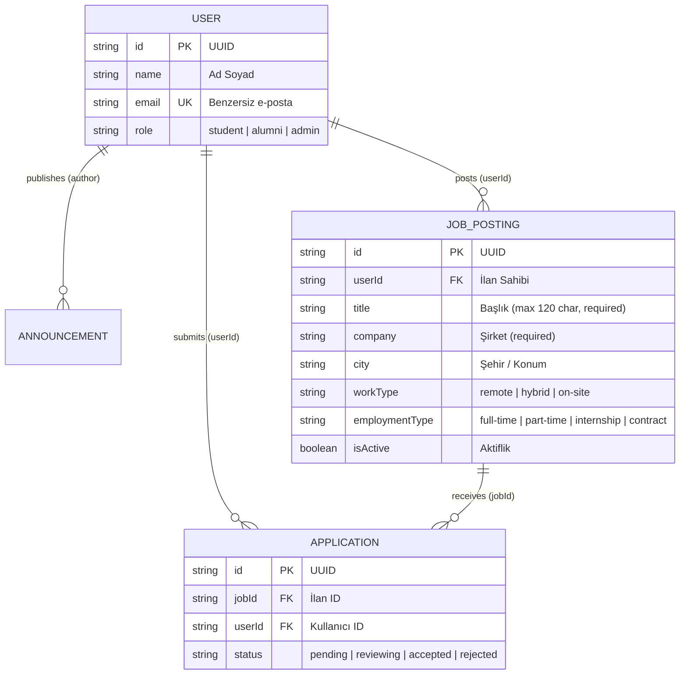

# Domain-Driven Design (DDD) & Data Design Documentation

## Alumni Network - Backend API Veri ve Alan Tasarım Dokümanı

Bu doküman, **Alumni Network Platformu** için Domain-Driven Design (DDD) ilkeleri doğrultusunda belirlenmiş Bounded Context (Sınırlandırılmış Bağlam), Varlıklar (Entities), Değer Nesneleri (Value Objects), İlişkisel Veri Tasarımı (ERD) ve Alan İş Kurallarını (Domain Rules & Invariants) içermektedir.

---

## 📌 İçindekiler
1. [Giriş ve Amaç](#1-giriş-ve-amaç)
2. [Bounded Contexts (Sınırlandırılmış Bağlamlar)](#2-bounded-contexts)
3. [Veri Varlıkları ve Alan Kuralları (Domain Entities & Invariants)](#3-veri-varlıkları-ve-alan-kuralları)
   - [3.1 User (Kullanıcı / Mezun)](#31-user-kullanıcı--mezun)
   - [3.2 Announcement (Duyuru / Haber)](#32-announcement-duyuru--haber)
   - [3.3 JobPosting (İş & Staj İlanı) - Temel Kurallar](#33-jobposting-iş--staj-ilanı)
   - [3.4 Application (İş & Staj Başvurusu)](#34-application-iş--staj-başvurusu)
4. [Varlık-İlişki Diyagramı (ERD)](#4-varlık-ilişki-diyagramı-erd)
5. [Depolama ve Kalıcılık Stratejisi (Storage & Persistence)](#5-depolama-ve-kalıcılık-stratejisi)
6. [Hata & Muhafız (Guardian) Politikası](#6-hata--muhafız-guardian-politikası)
7. [İlişkisel Veritabanına (RDBMS) Geçiş ve Şema](#7-ilişkisel-veritabanına-rdbms-geçiş-ve-şema)

---

## 1. Giriş ve Amaç

Bu doküman, Alumni Network projesinin alan (domain) ve veri katmanının teknik tasarımını ortaya koyar:
- Platformdaki kullanıcı profilleri, duyurular, iş ilanları ve başvuruların veri yapısını standartlaştırmak,
- Alan modellerinde iş kurallarını (Domain Invariants) garanti altına almak,
- Konteyner ve süreç döngülerinde veri kaybını önleyen kalıcılık mekanizmasını dokümante etmek,
- PostgreSQL / RDBMS entegrasyonuna temel oluşturmaktır.

---

## 2. Bounded Contexts

Sistem üç ana alt alana (Subdomains / Bounded Contexts) ayrılmıştır:

1. **Identity & User Management Context (Kullanıcı & Profil Yönetimi):**
   Mezunlar, öğrenciler ve yöneticilerin kimlik, eğitim bilgisi, mesleki deneyim ve profillerini yönetir.
2. **Community & Announcements Context (Topluluk & Duyuru Yönetimi):**
   Ağ geneline veya belirli kitlelere yönelik haber, etkinlik ve duyuruların yayımlanmasını ve takibini yönetir.
3. **Careers & Opportunities Context (Kariyer & İlan Yönetimi):**
   Mezunlar ve işverenler tarafından paylaşılan iş ilanları (`JobPosting`), staj olanakları ve başvuruları (`Application`) yönetir.

---

## 3. Veri Varlıkları ve Alan Kuralları

### 3.1 User (Kullanıcı / Mezun)
[`src/models/User.js`](src/models/User.js) modeli, mezunları, mevcut öğrencileri ve sistem yöneticilerini temsil eder.

- **`name`**: Zorunlu (`required`), minimum 2 karakter.
- **`email`**: Zorunlu (`required`), benzersiz (`unique`), geçerli RFC 5322 e-posta formatı.
- **`role`**: `'student'`, `'alumni'`, `'admin'`. Public registration may create only `student` or `alumni`; administrator promotion is a trusted operator action.
- **Authentication credential**: `password_hash` stores a salted scrypt hash, never a raw password. The model removes password values from JSON serialization.
- **Authorization**: server middleware resolves the signed session to the current user and checks the current database role on each request. Admin-only actions are not granted by client-supplied role fields.

### 3.1.1 Authentication & Authorization Context

The Identity context owns registration, login, logout, signed HttpOnly cookies, password hashing, and role checks. Roles are:

| Role | Capabilities |
|---|---|
| `student` | Personal account workspace and student-facing navigation |
| `alumni` | Personal account workspace and alumni-facing navigation |
| `admin` | Admin dashboard, role assignment, and protected user-management operations |

A public registration request is always constrained to `student` or `alumni`. An existing account is promoted by an operator using `scripts/promote-admin.js`. The session token carries an expiry and user ID; authorization reads the current user record so role changes take effect without trusting stale client claims.
- **`graduationYear`**: 1900 ile günümüz yılı + 10 arasında bir tam sayı.

---

### 3.2 Announcement (Duyuru / Haber)
[`src/models/Announcement.js`](src/models/Announcement.js) modeli, topluluk haberleri, etkinlikler ve duyuruları temsil eder.

- **`title`**: Zorunlu (`required`), boş bırakılamaz.
- **`content`**: Zorunlu (`required`), en az 10 karakter.
- **`category`**: `'general'`, `'academic'`, `'career'`, `'event'`.
- **`priority`**: `'low'`, `'medium'`, `'high'`, `'urgent'`.

---

### 3.3 JobPosting (İş & Staj İlanı)

[`src/models/JobPosting.js`](src/models/JobPosting.js) varlığı, mezunların ve kurumların paylaştığı kariyer fırsatlarını temsil eden Aggregation Root'tur.

#### 📌 Temel Alan Kuralları (Domain Invariants & Rules):

| Alan Adı | Tip | Zorunluluk | Kurallar & Kısıtlamalar |
| :--- | :--- | :--- | :--- |
| **`title`** | `String` | **Zorunlu (Required)** | • Boş bırakılamaz.<br>• Başındaki ve sonundaki boşluklar kırpılır (trimmed).<br>• **Maksimum 120 karakter** (`max 120 characters`). |
| **`company`** | `String` | **Zorunlu (Required)** | • Boş bırakılamaz.<br>• İlanı yayımlayan şirket veya kurum adı. |
| **`city` / `location`** | `String` | **Belirtilmiş / Konum** | • İlanın çalışma şehri / lokasyonu (örn: "İstanbul", "Ankara", "Remote"). |
| **`description`** | `String` | Opsiyonel / Detay | Pozisyon tanımı, görevler ve aranan nitelikler. |
| **`workType`** | `Enum` | Varsayılan: `'hybrid'` | `'remote'`, `'hybrid'`, `'on-site'` |
| **`employmentType`** | `Enum` | Varsayılan: `'full-time'` | `'full-time'`, `'part-time'`, `'internship'`, `'contract'` |
| **`experienceLevel`** | `Enum` | Varsayılan: `'mid'` | `'intern'`, `'entry'`, `'mid'`, `'senior'`, `'lead'` |
| **`contactEmail` / `applicationUrl`** | `String` | Opsiyonel | Başvuru kanalı veya iletişim adresi. |
| **`isActive`** | `Boolean` | Varsayılan: `true` | İlanın aktif olarak yayında olma durumu. |
| **`deadline`** | `ISO Date` | Opsiyonel | Son başvuru tarihi. |
| **`createdAt`** | `ISO Date` | Otomatik | İlan oluşturulma zaman damgası. |
| **`updatedAt`** | `ISO Date` | Otomatik | Son güncelleme zaman damgası. |

#### 🔍 Doğrulama Mantığı (Domain Invariant Checks):
```javascript
// JobPosting Invariant Kontrolü
if (!title || typeof title !== 'string' || title.trim().length === 0) {
  throw new Error('İş ilanı başlığı (title) zorunludur.');
}
if (title.trim().length > 120) {
  throw new Error('İş ilanı başlığı (title) en fazla 120 karakter olabilir.');
}
if (!company || typeof company !== 'string' || company.trim().length === 0) {
  throw new Error('Şirket/kurum adı (company) zorunludur.');
}
```

---

### 3.4 Application (İş & Staj Başvurusu)
[`src/models/Application.js`](src/models/Application.js) varlığı, bir kullanıcının iş ilanına yaptığı başvuruyu temsil eder.

- **`jobId`**: Zorunlu (`UUID`), ilanın ID'si (`job_postings.id` FK).
- **`userId`**: Zorunlu (`UUID`), başvuran kullanıcının ID'si (`users.id` FK).
- **`status`**: `'pending'`, `'reviewing'`, `'accepted'`, `'rejected'`, `'withdrawn'`.
- **`uniqueConstraint`**: Bir kullanıcı aynı ilana sadece bir kez başvurabilir (`UNIQUE (job_id, user_id)`).

---

## 4. Varlık-İlişki Diyagramı (ERD)



---

## 5. Depolama ve Kalıcılık Stratejisi

- **Hibrit Depolama:** PostgreSQL bağlantısı mevcut olduğunda ilişkisel veri tabanını kullanır; veritabanı erişilemediğinde `data/*.json` dosya depolama sistemi ile kesintisiz çalışmaya devam eder.
- **Bellek İçi Önbellek:** Hızlı okuma sorguları için modeller bellek içi Map önbelleğinden yanıt verir, yazma operasyonları diske ve veri tabanına asenkron yansıtılır.

---

## 6. Hata & Muhafız (Guardian) Politikası

1. **404 Guardian:** Tanımlanmayan veya geçersiz kalan rotaları yakalar. REST API istemcilerine anlaşılır `reason` alanı ile 404 JSON yanıtı döner; tarayıcı kullanıcılarını ise `/404` generic sayfasına yönlendirir.
2. **5xx Guardian:** Yakalanmamış sunucu istisnalarını güvenle karşılar, `logs/error.log` kütüğüne zaman damgası ve yığın izi (stack trace) ile kaydeder, istemciye güvenli 500 yanıtı döner.
3. **Logger:** Tüm gelen istekleri terminalde `[raw time] [method] [route] [status] [res type] [duration]` formatında kayıt altına alır.

---

## 7. İlişkisel Veritabanına (RDBMS) Geçiş ve Şema

```sql
CREATE EXTENSION IF NOT EXISTS "pgcrypto";

CREATE TABLE IF NOT EXISTS job_postings (
    id UUID PRIMARY KEY DEFAULT gen_random_uuid(),
    user_id UUID REFERENCES users(id) ON DELETE CASCADE,
    title VARCHAR(120) NOT NULL,
    company VARCHAR(255) NOT NULL,
    location VARCHAR(255) NOT NULL,
    work_type VARCHAR(50) DEFAULT 'hybrid',
    employment_type VARCHAR(50) DEFAULT 'full-time',
    experience_level VARCHAR(50) DEFAULT 'mid',
    description TEXT NOT NULL,
    requirements TEXT[] DEFAULT '{}',
    salary_range VARCHAR(100),
    application_url VARCHAR(500),
    is_active BOOLEAN DEFAULT TRUE,
    deadline TIMESTAMP WITH TIME ZONE,
    created_at TIMESTAMP WITH TIME ZONE DEFAULT CURRENT_TIMESTAMP,
    updated_at TIMESTAMP WITH TIME ZONE DEFAULT CURRENT_TIMESTAMP
);
```
