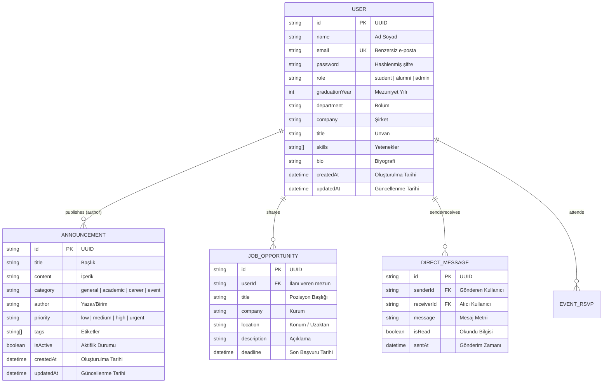

# Data Design Documentation (DDD)
## Alumni Network - Backend API Veri Tasarım Dokümanı

Bu doküman, **Alumni Network Platformu** veri modellerini, mimarisini, kalıcılık stratejilerini ve ilişkisel veri tasarımını ayrıntılı olarak açıklamaktadır.

---

## 📌 İçindekiler
1. [Giriş ve Amaç](#1-giriş-ve-amaç)
2. [Veri Varlıkları ve Şemaları (Data Entities & Schemas)](#2-veri-varlıkları-ve-şemaları)
   - [2.1 User (Kullanıcı / Mezun)](#21-user-kullanıcı--mezun)
   - [2.2 Announcement (Duyuru / Haber)](#22-announcement-duyuru--haber)
   - [2.3 Gelecekte Planlanan Varlıklar (Future Entities)](#23-gelecekte-planlanan-varlıklar)
3. [Varlık-İlişki Diyagramı (ERD)](#3-varlık-ilişki-diyagramı-erd)
4. [Depolama ve Kalıcılık Stratejisi (Storage & Persistence)](#4-depolama-ve-kalıcılık-stratejisi)
   - [4.1 Dosya Tabanlı JSON Depolama Mimarisi](#41-dosya-tabanlı-json-depolama-mimarisi)
   - [4.2 Bellek İçi Önbellek & Eşzamanlama (Sync Strategy)](#42-bellek-içi-önbellek--eşzamanlama)
   - [4.3 Docker Volume & Kalıcılık (The Forgetting Test Uyumluluğu)](#43-docker-volume--kalıcılık)
5. [Veri Bütünlüğü ve Doğrulama Kuralları (Integrity & Validation)](#5-veri-bütünlüğü-ve-doğrulama-kuralları)
6. [Güvenlik ve Gizlilik (Security & Privacy)](#6-güvenlik-ve-gizlilik)
7. [İlişkisel Veritabanına (RDBMS) Geçiş Yol Haritası](#7-ilişkisel-veritabanına-rdbms-geçiş-yol-haritası)

---

## 1. Giriş ve Amaç

Bu doküman, Alumni Network projesinin veri katmanının teknik tasarımını ortaya koyar. Amaç:
- Platformdaki kullanıcı profilleri ve duyuruların veri yapısını standartlaştırmak,
- Veri erişim modellerinin (CRUD operasyonları) mimari prensiplerini belirlemek,
- Konteyner ve süreç döngülerinde veri kaybını önleyen kalıcılık mekanizmasını dokümante etmek,
- Gelecekteki ilişkisel veritabanı (PostgreSQL / MySQL) entegrasyonuna temel oluşturmaktır.

---

## 2. Veri Varlıkları ve Şemaları

### 2.1 User (Kullanıcı / Mezun)
[`src/models/User.js`](file:///c:/Users/sefe.turan/alumni/src/models/User.js) modeli, mezunları, mevcut öğrencileri ve sistem yöneticilerini temsil eder.

| Alan Adı | Veri Tipi | Zorunlu | Varsayılan | Açıklama |
| :--- | :--- | :--- | :--- | :--- |
| `id` | `UUID v4` | Evet | `crypto.randomUUID()` | Benzersiz kullanıcı kimliği |
| `name` | `String` | Evet | - | Kullanıcının adı ve soyadı |
| `email` | `String` | Evet | - | Benzersiz e-posta adresi (küçük harfe normalize edilir) |
| `password` | `String` | Hayır | `undefined` | Hash'lenmiş parola (bcrypt) |
| `role` | `Enum` | Evet | `'alumni'` | `'student'`, `'alumni'`, `'admin'` |
| `graduationYear` | `Number` | Hayır | `null` | Mezuniyet yılı (örn: 2024) |
| `department` | `String` | Hayır | `null` | Bölüm / Fakülte |
| `company` | `String` | Hayır | `null` | Çalıştığı güncel şirket/kurum |
| `title` | `String` | Hayır | `null` | Görev unvanı |
| `skills` | `Array<String>` | Hayır | `[]` | Yetenek etiketleri |
| `bio` | `String` | Hayır | `""` | Kısa biyografi / özgeçmiş |
| `createdAt` | `ISO 8601` | Evet | Güncel Tarih | Kayıt oluşturulma zaman damgası |
| `updatedAt` | `ISO 8601` | Evet | Güncel Tarih | Son güncelleme zaman damgası |

#### JSON Temsili Örneği:
```json
{
  "id": "db75fa98-368c-4735-8ab7-37dfa4c4f8c8",
  "name": "Ayşe Yılmaz",
  "email": "ayse.yilmaz@alumni.org",
  "role": "alumni",
  "graduationYear": 2022,
  "department": "Bilgisayar Mühendisliği",
  "company": "Tech Solutions",
  "title": "Senior Software Architect",
  "skills": ["JavaScript", "Node.js", "Docker", "PostgreSQL"],
  "bio": "Açık kaynak teknolojileri ve bulut mimarisi meraklısı.",
  "createdAt": "2026-10-21T07:17:28.956Z",
  "updatedAt": "2026-10-21T07:17:28.956Z"
}
```

---

### 2.2 Announcement (Duyuru / Haber)
[`src/models/Announcement.js`](file:///c:/Users/sefe.turan/alumni/src/models/Announcement.js) modeli, topluluk haberleri, etkinlikler ve kariyer fırsatlarını temsil eder.

| Alan Adı | Veri Tipi | Zorunlu | Varsayılan | Açıklama |
| :--- | :--- | :--- | :--- | :--- |
| `id` | `UUID v4` | Evet | `crypto.randomUUID()` | Benzersiz duyuru kimliği |
| `title` | `String` | Evet | - | Duyuru başlığı |
| `content` | `String` | Evet | - | Duyuru içeriği / açıklaması |
| `category` | `Enum` | Evet | `'general'` | `'general'`, `'academic'`, `'career'`, `'event'` |
| `author` | `String` | Evet | `'Alumni Network Yönetimi'` | Duyuruyu yayınlayan kişi/birim |
| `priority` | `Enum` | Evet | `'medium'` | `'low'`, `'medium'`, `'high'`, `'urgent'` |
| `tags` | `Array<String>` | Hayır | `[]` | Etiketler (örn: `["Networking", "Kariyer"]`) |
| `isActive` | `Boolean` | Evet | `true` | Yayında olma durumu |
| `createdAt` | `ISO 8601` | Evet | Güncel Tarih | Yayın tarihi (yeniden eskiye sıralanır) |
| `updatedAt` | `ISO 8601` | Evet | Güncel Tarih | Son güncelleme tarihi |

#### JSON Temsili Örneği:
```json
{
  "id": "b0633eda-6c62-41ff-98ff-989503e72518",
  "title": "2026 Yıllık Mezunlar Buluşması",
  "content": "Tüm mezunlarımızı kampüste düzenlenecek geleneksel buluşmaya davet ediyoruz.",
  "category": "event",
  "author": "Rektörlük Mezun Ofisi",
  "priority": "high",
  "tags": ["Buluşma", "Etkinlik", "Kampüs"],
  "isActive": true,
  "createdAt": "2026-10-21T07:17:28.960Z",
  "updatedAt": "2026-10-21T07:17:28.960Z"
}
```

---

### 2.3 Gelecekte Planlanan Varlıklar

1. **JobOpportunity (İş & Staj İlanı):** Mezunların veya işverenlerin paylaştığı iş fırsatları.
2. **DirectMessage (Birebir Mesajlaşma):** Mezunlar arası doğrudan iletişim kayıtları.
3. **Event (Etkinlik):** Katılımcı listesi (RSVP) ve mekan detayları içeren takvim etkinlikleri.

---

## 3. Varlık-İlişki Diyagramı (ERD)



---

## 4. Depolama ve Kalıcılık Stratejisi

### 4.1 Dosya Tabanlı JSON Depolama Mimarisi
Mevcut mimaride harici bir veritabanı sürücüsü bağımlılığı olmadan, hızlı ve taşınabilir JSON dosya depolama sistemi kullanılmaktadır:
- Kullanıcılar: `DATA_DIR/users.json`
- Duyurular: `DATA_DIR/announcements.json`

Dosya yolu ortam değişkeni ile dinamik olarak belirlenir:
```javascript
const DATA_DIR = process.env.DATA_DIR || path.join(__dirname, '../../data');
```

### 4.2 Bellek İçi Önbellek & Eşzamanlama (Sync Strategy)
- **Okuma Performansı:** Model ilk yüklendiğinde diskteki dosya okunur ve bellek içi `Map` nesnesine (`usersStore`, `announcementsStore`) aktarılır. Arama ve listeleme sorguları bellekten $O(1)$ veya $O(N)$ hızında yanıtlanır.
- **Yazma Güvenliği:** `create`, `findByIdAndUpdate`, `findByIdAndDelete` ve `clear` gibi veriyi değiştiren tüm operasyonlarda bellek güncellendikten hemen sonra asenkron olarak diske `fs.promises.writeFile` ile tam seri yazma yapılır.

### 4.3 Docker Volume & Kalıcılık (The Forgetting Test Uyumluluğu)
Konteyner ortamında verilerin silinmesini önlemek için [`docker-compose.yml`](file:///c:/Users/sefe.turan/alumni/docker-compose.yml) içinde **Named Volume** tanımlanmıştır:

```yaml
services:
  app:
    volumes:
      - alumni_data:/app/data

volumes:
  alumni_data:
    name: alumni_data
```

Bu tasarım sayesinde:
- `docker compose down` komutu konteyneri yıksa dahi `alumni_data` volume'ü silinmez.
- `docker compose up` çalıştırıldığında yeni konteyner aynı veri dizinine bağlanır ve tüm kayıtlar eksiksiz okunur.
- Otomatik unutma testi [`scripts/test-forgetting.js`](file:///c:/Users/sefe.turan/alumni/scripts/test-forgetting.js) ile bu davranış sürekli doğrulanabilir.

---

## 5. Veri Bütünlüğü ve Doğrulama Kuralları

1. **Benzersizlik (Uniqueness):**
   - Kullanıcıların `email` alanı benzersizdir (case-insensitive doğrulama yapılır). Aynı e-posta ile ikinci kayıt açılamaz.
2. **Kimlik Üretimi:**
   - Tüm ID'ler RFC 4122 uyumlu standart `crypto.randomUUID()` ile kriptografik olarak rastgele üretilir.
3. **Zorunlu Alan Kontrolleri:**
   - Kullanıcı için `name` ve `email` alanları boş bırakılamaz.
   - Duyuru için `title` ve `content` alanları zorunludur.
4. **Tip Dönüşümleri:**
   - `graduationYear` sayısal değere (`Number`) cast edilir.
   - `skills` ve `tags` dizileri doğrulanamadığında boş dizi `[]` olarak ilklendirilir.

---

## 6. Güvenlik ve Gizlilik

1. **Hassas Veri Sanitizasyonu (`toJSON`):**
   - `User.prototype.toJSON()` metodu, parola hash'i (`password`) gibi hassas alanları yanıttan ayıklar.
2. **Veri İzolasyonu:**
   - Diskteki `data/` dizini [`.gitignore`](file:///c:/Users/sefe.turan/alumni/.gitignore) ve [`.dockerignore`](file:///c:/Users/sefe.turan/alumni/.dockerignore) dosyalarına eklenerek test ve canlı verilerin git deposuna sızması engellenmiştir.

---

## 7. İlişkisel Veritabanına (RDBMS) Geçiş Yol Haritası

İlerleyen aşamalarda PostgreSQL entegrasyonu planlandığında uygulanacak SQL şeması:

```sql
-- Kullanıcılar Tablosu
CREATE TABLE users (
    id UUID PRIMARY KEY DEFAULT gen_random_uuid(),
    name VARCHAR(255) NOT NULL,
    email VARCHAR(255) UNIQUE NOT NULL,
    password_hash VARCHAR(255),
    role VARCHAR(50) DEFAULT 'alumni' CHECK (role IN ('student', 'alumni', 'admin')),
    graduation_year INT,
    department VARCHAR(255),
    company VARCHAR(255),
    title VARCHAR(255),
    skills TEXT[],
    bio TEXT,
    created_at TIMESTAMP WITH TIME ZONE DEFAULT CURRENT_TIMESTAMP,
    updated_at TIMESTAMP WITH TIME ZONE DEFAULT CURRENT_TIMESTAMP
);

-- Duyurular Tablosu
CREATE TABLE announcements (
    id UUID PRIMARY KEY DEFAULT gen_random_uuid(),
    title VARCHAR(255) NOT NULL,
    content TEXT NOT NULL,
    category VARCHAR(50) DEFAULT 'general' CHECK (category IN ('general', 'academic', 'career', 'event')),
    author VARCHAR(255) DEFAULT 'Alumni Network Yönetimi',
    priority VARCHAR(50) DEFAULT 'medium' CHECK (priority IN ('low', 'medium', 'high', 'urgent')),
    tags TEXT[],
    is_active BOOLEAN DEFAULT TRUE,
    created_at TIMESTAMP WITH TIME ZONE DEFAULT CURRENT_TIMESTAMP,
    updated_at TIMESTAMP WITH TIME ZONE DEFAULT CURRENT_TIMESTAMP
);

-- İndeksler
CREATE INDEX idx_users_email ON users(email);
CREATE INDEX idx_users_role ON users(role);
CREATE INDEX idx_announcements_created_at ON announcements(created_at DESC);
```
