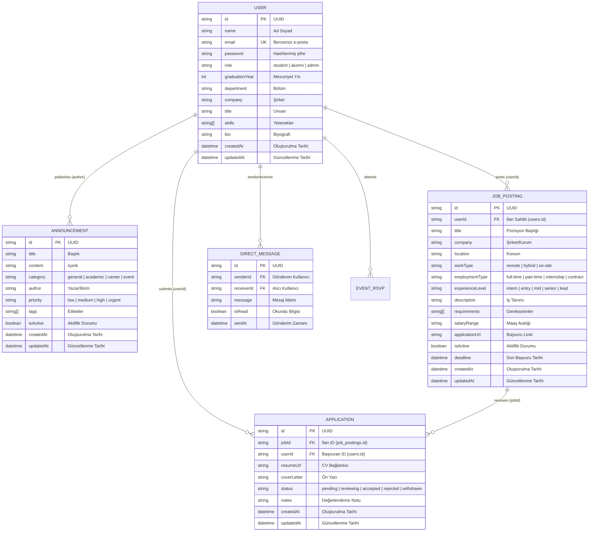

# Data Design Documentation (DDD)
## Alumni Network - Backend API Veri Tasarım Dokümanı

Bu doküman, **Alumni Network Platformu** veri modellerini, mimarisini, kalıcılık stratejilerini ve ilişkisel veri tasarımını ayrıntılı olarak açıklamaktadır.

---

## 📌 İçindekiler
1. [Giriş ve Amaç](#1-giriş-ve-amaç)
2. [Veri Varlıkları ve Şemaları (Data Entities & Schemas)](#2-veri-varlıkları-ve-şemaları)
   - [2.1 User (Kullanıcı / Mezun)](#21-user-kullanıcı--mezun)
   - [2.2 Announcement (Duyuru / Haber)](#22-announcement-duyuru--haber)
   - [2.3 JobPosting (İş & Staj İlanı)](#23-jobposting-iş--staj-ilanı)
   - [2.4 Application (İş & Staj Başvurusu)](#24-application-iş--staj-başvurusu)
   - [2.5 Gelecekte Planlanan Diğer Varlıklar](#25-gelecekte-planlanan-diğer-varlıklar)
3. [Varlık-İlişki Diyagramı (ERD)](#3-varlık-ilişki-diyagramı-erd)
4. [Depolama ve Kalıcılık Stratejisi (Storage & Persistence)](#4-depolama-ve-kalıcılık-stratejisi)
   - [4.1 Dosya Tabanlı JSON Depolama Mimarisi](#41-dosya-tabanlı-json-depolama-mimarisi)
   - [4.2 Bellek İçi Önbellek & Eşzamanlama (Sync Strategy)](#42-bellek-içi-önbellek--eşzamanlama)
   - [4.3 Docker Volume & Kalıcılık (The Forgetting Test Uyumluluğu)](#43-docker-volume--kalıcılık)
5. [Veri Bütünlüğü ve Doğrulama Kuralları (Integrity & Validation)](#5-veri-bütünlüğü-ve-doğrulama-kuralları)
6. [Güvenlik ve Gizlilik (Security & Privacy)](#6-güvenlik-ve-gizlilik)
7. [İlişkisel Veritabanına (RDBMS) Geçiş Yol Haritası](#7-ilişkisel-veritabanına-rdbms-geçiş-yol-haritası)

---

## 1. Giriş ve Amaç

Bu doküman, Alumni Network projesinin veri katmanının teknik tasarımını ortaya koyar. Amaç:
- Platformdaki kullanıcı profilleri, duyurular, iş ilanları ve iş başvurularının veri yapısını standartlaştırmak,
- Veri erişim modellerinin (CRUD operasyonları) mimari prensiplerini belirlemek,
- Konteyner ve süreç döngülerinde veri kaybını önleyen kalıcılık mekanizmasını dokümante etmek,
- Gelecekteki ilişkisel veritabanı (PostgreSQL / MySQL) entegrasyonuna temel oluşturmaktır.

---

## 2. Veri Varlıkları ve Şemaları

### 2.1 User (Kullanıcı / Mezun)
[`src/models/User.js`](file:///c:/Users/sefe.turan/alumni/src/models/User.js) modeli, mezunları, mevcut öğrencileri ve sistem yöneticilerini temsil eder.

| Alan Adı | Veri Tipi | Zorunlu | Varsayılan | Açıklama |
| :--- | :--- | :--- | :--- | :--- |
| `id` | `UUID v4` | Evet | `crypto.randomUUID()` | Benzersiz kullanıcı kimliği |
| `name` | `String` | Evet | - | Kullanıcının adı ve soyadı |
| `email` | `String` | Evet | - | Benzersiz e-posta adresi (küçük harfe normalize edilir) |
| `password` | `String` | Hayır | `undefined` | Hash'lenmiş parola (bcrypt) |
| `role` | `Enum` | Evet | `'alumni'` | `'student'`, `'alumni'`, `'admin'` |
| `graduationYear` | `Number` | Hayır | `null` | Mezuniyet yılı (örn: 2024) |
| `department` | `String` | Hayır | `null` | Bölüm / Fakülte |
| `company` | `String` | Hayır | `null` | Çalıştığı güncel şirket/kurum |
| `title` | `String` | Hayır | `null` | Görev unvanı |
| `skills` | `Array<String>` | Hayır | `[]` | Yetenek etiketleri |
| `bio` | `String` | Hayır | `""` | Kısa biyografi / özgeçmiş |
| `createdAt` | `ISO 8601` | Evet | Güncel Tarih | Kayıt oluşturulma zaman damgası |
| `updatedAt` | `ISO 8601` | Evet | Güncel Tarih | Son güncelleme zaman damgası |

#### JSON Temsili Örneği:
```json
{
  "id": "db75fa98-368c-4735-8ab7-37dfa4c4f8c8",
  "name": "Ayşe Yılmaz",
  "email": "ayse.yilmaz@alumni.org",
  "role": "alumni",
  "graduationYear": 2022,
  "department": "Bilgisayar Mühendisliği",
  "company": "Tech Solutions",
  "title": "Senior Software Architect",
  "skills": ["JavaScript", "Node.js", "Docker", "PostgreSQL"],
  "bio": "Açık kaynak teknolojileri ve bulut mimarisi meraklısı.",
  "createdAt": "2026-10-21T07:17:28.956Z",
  "updatedAt": "2026-10-21T07:17:28.956Z"
}
```

---

### 2.2 Announcement (Duyuru / Haber)
[`src/models/Announcement.js`](file:///c:/Users/sefe.turan/alumni/src/models/Announcement.js) modeli, topluluk haberleri, etkinlikler ve duyuruları temsil eder.

| Alan Adı | Veri Tipi | Zorunlu | Varsayılan | Açıklama |
| :--- | :--- | :--- | :--- | :--- |
| `id` | `UUID v4` | Evet | `crypto.randomUUID()` | Benzersiz duyuru kimliği |
| `title` | `String` | Evet | - | Duyuru başlığı |
| `content` | `String` | Evet | - | Duyuru içeriği / açıklaması |
| `category` | `Enum` | Evet | `'general'` | `'general'`, `'academic'`, `'career'`, `'event'` |
| `author` | `String` | Evet | `'Alumni Network Yönetimi'` | Duyuruyu yayınlayan kişi/birim |
| `priority` | `Enum` | Evet | `'medium'` | `'low'`, `'medium'`, `'high'`, `'urgent'` |
| `tags` | `Array<String>` | Hayır | `[]` | Etiketler (örn: `["Networking", "Kariyer"]`) |
| `isActive` | `Boolean` | Evet | `true` | Yayında olma durumu |
| `createdAt` | `ISO 8601` | Evet | Güncel Tarih | Yayın tarihi (yeniden eskiye sıralanır) |
| `updatedAt` | `ISO 8601` | Evet | Güncel Tarih | Son güncelleme tarihi |

#### JSON Temsili Örneği:
```json
{
  "id": "b0633eda-6c62-41ff-98ff-989503e72518",
  "title": "2026 Yıllık Mezunlar Buluşması",
  "content": "Tüm mezunlarımızı kampüste düzenlenecek geleneksel buluşmaya davet ediyoruz.",
  "category": "event",
  "author": "Rektörlük Mezun Ofisi",
  "priority": "high",
  "tags": ["Buluşma", "Etkinlik", "Kampüs"],
  "isActive": true,
  "createdAt": "2026-10-21T07:17:28.960Z",
  "updatedAt": "2026-10-21T07:17:28.960Z"
}
```

---

### 2.3 JobPosting (İş & Staj İlanı)
[`src/models/JobPosting.js`](file:///c:/Users/sefe.turan/alumni/src/models/JobPosting.js) varlığı, mezunların, akademisyenlerin ve işverenlerin paylaştığı kariyer fırsatlarını temsil eder.

| Alan Adı | Veri Tipi | Zorunlu | Varsayılan | Açıklama |
| :--- | :--- | :--- | :--- | :--- |
| `id` | `UUID v4` | Evet | `crypto.randomUUID()` | Benzersiz ilan kimliği |
| `userId` | `UUID v4` | Evet | - | İlanı yayınlayan kullanıcının ID'si (`users.id` Foreign Key) |
| `title` | `String` | Evet | - | Pozisyon başlığı (örn: "Backend Developer") |
| `company` | `String` | Evet | - | İlan sahibi şirket veya kurum adı |
| `location` | `String` | Evet | - | Konum bilgisi (örn: "İstanbul / Maslak", "Remote") |
| `workType` | `Enum` | Evet | `'hybrid'` | Çalışma şekli: `'remote'`, `'hybrid'`, `'on-site'` |
| `employmentType` | `Enum` | Evet | `'full-time'` | İstihdam türü: `'full-time'`, `'part-time'`, `'internship'`, `'contract'` |
| `experienceLevel` | `Enum` | Evet | `'mid'` | Deneyim seviyesi: `'intern'`, `'entry'`, `'mid'`, `'senior'`, `'lead'` |
| `description` | `String` | Evet | - | Pozisyonun detaylı görev ve iş tanımı |
| `requirements` | `Array<String>` | Hayır | `[]` | Aranan teknik ve kişisel yetkinlikler |
| `salaryRange` | `String` | Hayır | `null` | Maaş veya bütçe aralığı (örn: "80.000 - 120.000 TL") |
| `applicationUrl` | `String` | Hayır | `null` | Başvuru linki veya iletişim e-posta adresi |
| `isActive` | `Boolean` | Evet | `true` | İlanın aktif olarak yayında olma durumu |
| `deadline` | `ISO 8601` | Hayır | `null` | Son başvuru tarihi |
| `createdAt` | `ISO 8601` | Evet | Güncel Tarih | İlan oluşturulma zaman damgası |
| `updatedAt` | `ISO 8601` | Evet | Güncel Tarih | Son güncelleme zaman damgası |

---

### 2.4 Application (İş & Staj Başvurusu)
[`src/models/Application.js`](file:///c:/Users/sefe.turan/alumni/src/models/Application.js) varlığı, mezunların veya öğrencilerin bir iş ilanına (`JobPosting`) yaptığı başvuruyu temsil eder.

| Alan Adı | Veri Tipi | Zorunlu | Varsayılan | Açıklama |
| :--- | :--- | :--- | :--- | :--- |
| `id` | `UUID v4` | Evet | `crypto.randomUUID()` | Benzersiz başvuru kimliği |
| `jobId` | `UUID v4` | Evet | - | Başvurulan iş ilanının ID'si (`job_postings.id` FK) |
| `userId` | `UUID v4` | Evet | - | Başvuru yapan kullanıcının ID'si (`users.id` FK) |
| `resumeUrl` | `String` | Hayır | `null` | CV / Portfolyo bağlantısı |
| `coverLetter` | `String` | Hayır | `""` | Ön yazı / motivasyon mektubu |
| `status` | `Enum` | Evet | `'pending'` | Durum: `'pending'`, `'reviewing'`, `'accepted'`, `'rejected'`, `'withdrawn'` |
| `notes` | `String` | Hayır | `null` | Değerlendirme notları |
| `createdAt` | `ISO 8601` | Evet | Güncel Tarih | Başvuru oluşturulma zaman damgası |
| `updatedAt` | `ISO 8601` | Evet | Güncel Tarih | Son durum güncelleme zaman damgası |

#### JSON Temsili Örneği:
```json
{
  "id": "c1f7b830-4e2a-4a11-893d-8e7c10b25e77",
  "jobId": "e4f8b912-87c3-4d2a-a921-9657b01e3456",
  "userId": "db75fa98-368c-4735-8ab7-37dfa4c4f8c8",
  "resumeUrl": "https://storage.alumni.org/resumes/ayse-yilmaz-cv.pdf",
  "coverLetter": "Merhaba, ilanınızdaki pozisyon için deneyimlerimin uygun olduğunu düşünerek başvuruyorum.",
  "status": "pending",
  "notes": null,
  "createdAt": "2026-10-21T08:30:00.000Z",
  "updatedAt": "2026-10-21T08:30:00.000Z"
}
```

---

### 2.5 Gelecekte Planlanan Diğer Varlıklar

1. **DirectMessage (Birebir Mesajlaşma):** Mezunlar arası doğrudan iletişim kayıtları (`senderId`, `receiverId`, `message`, `isRead`).
2. **Event (Etkinlik):** Katılımcı listesi (`EventRSVP`), bilet/kontenjan ve mekan detayları içeren takvim etkinlikleri.

---

## 3. Varlık-İlişki Diyagramı (ERD)



---

## 4. Depolama ve Kalıcılık Stratejisi

### 4.1 Dosya Tabanlı JSON Depolama Mimarisi
Mevcut mimaride harici bir veritabanı sürücüsü bağımlılığı olmadan, hızlı ve taşınabilir JSON dosya depolama sistemi kullanılmaktadır:
- Kullanıcılar: `DATA_DIR/users.json`
- Duyurular: `DATA_DIR/announcements.json`
- İş İlanları: `DATA_DIR/job_postings.json`
- Başvurular: `DATA_DIR/applications.json`

Dosya yolu ortam değişkeni ile dinamik olarak belirlenir:
```javascript
const DATA_DIR = process.env.DATA_DIR || path.join(__dirname, '../../data');
```

### 4.2 Bellek İçi Önbellek & Eşzamanlama (Sync Strategy)
- **Okuma Performansı:** Model ilk yüklendiğinde diskteki dosya okunur ve bellek içi `Map` nesnesine aktarılır.
- **Yazma Güvenliği:** `create`, `findByIdAndUpdate`, `findByIdAndDelete` ve `clear` işlemlerinde bellek güncellendikten hemen sonra diske asenkron `fs.promises.writeFile` ile tam seri yazma yapılır.

### 4.3 Docker Volume & Kalıcılık (The Forgetting Test Uyumluluğu)
Konteyner ortamında verilerin silinmesini önlemek için [`docker-compose.yml`](file:///c:/Users/sefe.turan/alumni/docker-compose.yml) içinde **Named Volume** tanımlanmıştır (`alumni_data:/app/data`).

---

## 5. Veri Bütünlüğü ve Doğrulama Kuralları

1. **Benzersizlik (Uniqueness):**
   - Kullanıcıların `email` alanı benzersizdir.
   - Bir kullanıcı aynı ilana yalnızca bir kez başvurabilir (`UNIQUE (job_id, user_id)`).
2. **Kimlik Üretimi:**
   - Tüm ID'ler RFC 4122 uyumlu standart `crypto.randomUUID()` ile üretilir.
3. **Zorunlu Alan Kontrolleri:**
   - **User:** `name`, `email`.
   - **Announcement:** `title`, `content`.
   - **JobPosting:** `title`, `company`, `location`, `description`, `userId`.
   - **Application:** `jobId`, `userId`.
4. **İlişkisel Bütünlük (Referential Integrity):**
   - `job_postings.userId` -> `users.id` (`ON DELETE CASCADE`).
   - `applications.jobId` -> `job_postings.id` (`ON DELETE CASCADE`).
   - `applications.userId` -> `users.id` (`ON DELETE CASCADE`).
5. **Tip Dönüşümleri & Enum Kısıtları:**
   - `status`: `'pending'`, `'reviewing'`, `'accepted'`, `'rejected'`, `'withdrawn'`.

---

## 6. Güvenlik ve Gizlilik

1. **Hassas Veri Sanitizasyonu (`toJSON`):**
   - `User.prototype.toJSON()` metodu, parola hash'i (`password`) gibi hassas alanları yanıttan ayıklar.
2. **Veri İzolasyonu:**
   - Diskteki `data/` dizini [`.gitignore`](file:///c:/Users/sefe.turan/alumni/.gitignore) ve [`.dockerignore`](file:///c:/Users/sefe.turan/alumni/.dockerignore) dosyalarına eklenerek korunmuştur.

---

## 7. İlişkisel Veritabanına (RDBMS) Geçiş Yol Haritası

PostgreSQL şeması:

```sql
-- Gerekli Kriptografik Eklenti
CREATE EXTENSION IF NOT EXISTS "pgcrypto";

-- 1. Kullanıcılar Tablosu
CREATE TABLE IF NOT EXISTS users (
    id UUID PRIMARY KEY DEFAULT gen_random_uuid(),
    name VARCHAR(255) NOT NULL,
    email VARCHAR(255) UNIQUE NOT NULL,
    password_hash VARCHAR(255),
    role VARCHAR(50) DEFAULT 'alumni' CHECK (role IN ('student', 'alumni', 'admin')),
    graduation_year INT,
    department VARCHAR(255),
    company VARCHAR(255),
    title VARCHAR(255),
    skills TEXT[] DEFAULT '{}',
    bio TEXT DEFAULT '',
    created_at TIMESTAMP WITH TIME ZONE DEFAULT CURRENT_TIMESTAMP,
    updated_at TIMESTAMP WITH TIME ZONE DEFAULT CURRENT_TIMESTAMP
);

-- 2. Duyurular Tablosu
CREATE TABLE IF NOT EXISTS announcements (
    id UUID PRIMARY KEY DEFAULT gen_random_uuid(),
    title VARCHAR(255) NOT NULL,
    content TEXT NOT NULL,
    category VARCHAR(50) DEFAULT 'general' CHECK (category IN ('general', 'academic', 'career', 'event')),
    author VARCHAR(255) DEFAULT 'Alumni Network Yönetimi',
    priority VARCHAR(50) DEFAULT 'medium' CHECK (priority IN ('low', 'medium', 'high', 'urgent')),
    tags TEXT[] DEFAULT '{}',
    is_active BOOLEAN DEFAULT TRUE,
    created_at TIMESTAMP WITH TIME ZONE DEFAULT CURRENT_TIMESTAMP,
    updated_at TIMESTAMP WITH TIME ZONE DEFAULT CURRENT_TIMESTAMP
);

-- 3. İş ve Staj İlanları Tablosu (Job Postings)
CREATE TABLE IF NOT EXISTS job_postings (
    id UUID PRIMARY KEY DEFAULT gen_random_uuid(),
    user_id UUID NOT NULL REFERENCES users(id) ON DELETE CASCADE,
    title VARCHAR(255) NOT NULL,
    company VARCHAR(255) NOT NULL,
    location VARCHAR(255) NOT NULL,
    work_type VARCHAR(50) DEFAULT 'hybrid' CHECK (work_type IN ('remote', 'hybrid', 'on-site')),
    employment_type VARCHAR(50) DEFAULT 'full-time' CHECK (employment_type IN ('full-time', 'part-time', 'internship', 'contract')),
    experience_level VARCHAR(50) DEFAULT 'mid' CHECK (experience_level IN ('intern', 'entry', 'mid', 'senior', 'lead')),
    description TEXT NOT NULL,
    requirements TEXT[] DEFAULT '{}',
    salary_range VARCHAR(100),
    application_url VARCHAR(500),
    is_active BOOLEAN DEFAULT TRUE,
    deadline TIMESTAMP WITH TIME ZONE,
    created_at TIMESTAMP WITH TIME ZONE DEFAULT CURRENT_TIMESTAMP,
    updated_at TIMESTAMP WITH TIME ZONE DEFAULT CURRENT_TIMESTAMP
);

-- 4. İş Başvuruları Tablosu (Applications)
CREATE TABLE IF NOT EXISTS applications (
    id UUID PRIMARY KEY DEFAULT gen_random_uuid(),
    job_id UUID NOT NULL REFERENCES job_postings(id) ON DELETE CASCADE,
    user_id UUID NOT NULL REFERENCES users(id) ON DELETE CASCADE,
    resume_url VARCHAR(500),
    cover_letter TEXT DEFAULT '',
    status VARCHAR(50) DEFAULT 'pending' CHECK (status IN ('pending', 'reviewing', 'accepted', 'rejected', 'withdrawn')),
    notes TEXT,
    created_at TIMESTAMP WITH TIME ZONE DEFAULT CURRENT_TIMESTAMP,
    updated_at TIMESTAMP WITH TIME ZONE DEFAULT CURRENT_TIMESTAMP,
    CONSTRAINT unique_job_user_application UNIQUE (job_id, user_id)
);

-- İndeksler (Performans & Hızlı Sorgulama)
CREATE INDEX IF NOT EXISTS idx_users_email ON users(email);
CREATE INDEX IF NOT EXISTS idx_users_role ON users(role);
CREATE INDEX IF NOT EXISTS idx_announcements_created_at ON announcements(created_at DESC);
CREATE INDEX IF NOT EXISTS idx_job_postings_user_id ON job_postings(user_id);
CREATE INDEX IF NOT EXISTS idx_job_postings_created_at ON job_postings(created_at DESC);
CREATE INDEX IF NOT EXISTS idx_applications_job_id ON applications(job_id);
CREATE INDEX IF NOT EXISTS idx_applications_user_id ON applications(user_id);
CREATE INDEX IF NOT EXISTS idx_applications_status ON applications(status);
CREATE INDEX IF NOT EXISTS idx_applications_created_at ON applications(created_at DESC);
```
